# zmk-hub-display

A small Windows tray app for the 320x170 screen on the 佳点 V1 Pro hub. It turns the screen into a
live display for your ZMK keyboard, your Claude Code sessions and a clock with the weather, with an
animated Clawd keeping you company.

## Screens

**Keyboard** — the active layer, held modifiers and battery levels, straight from your ZMK dongle.

<table>
<tr><td>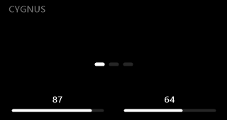</td></tr>
</table>

**Claude Code** — what Claude is doing right now, with Clawd acting it out, plus your 5-hour and
7-day usage.

<table>
<tr>
<td>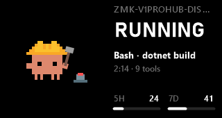</td>
<td>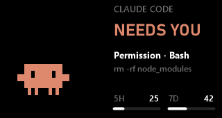</td>
<td>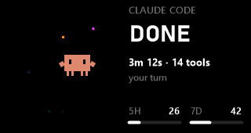</td>
</tr>
<tr><td>Working</td><td>Needs you</td><td>Done</td></tr>
</table>

**Clock** — three styles to choose from. Clawd changes with the time of day, the weather and holidays.

<table>
<tr>
<td>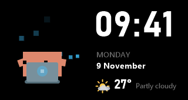</td>
<td>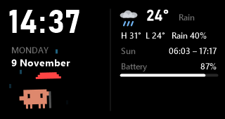</td>
<td>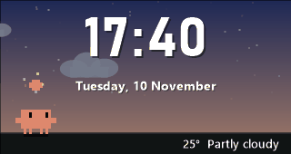</td>
</tr>
<tr><td>Companion</td><td>Dashboard</td><td>Sky, at dusk</td></tr>
<tr>
<td>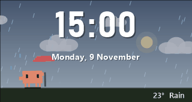</td>
<td>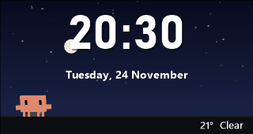</td>
<td></td>
</tr>
<tr><td>Sky, in the rain</td><td>Sky, at night</td><td></td></tr>
</table>

## Features

- **Keyboard screen**: layer names slide in as you switch, modifiers appear while held, one battery
  bar for a one-piece keyboard and two for a split. The hub screen sleeps when the keyboard does.
- **Claude Code screen**: thinking, running a tool, waiting for your permission, done or an error,
  each with its own Clawd. When several sessions run, the one that needs you comes first.
- **Clock screen**: Companion, Dashboard or Sky style; weather from Open-Meteo for the city you pick,
  no account or key needed.
- **Your choice of what shows**: pin one screen or rotate through several. Claude can take the hub
  over while it works or waits for you, and switching layers briefly brings the keyboard screen up.
- **Settings window and tray menu**: everything is set with a few clicks, including the hub's
  brightness, and the window shows a live copy of the hub.

<table>
<tr>
<td>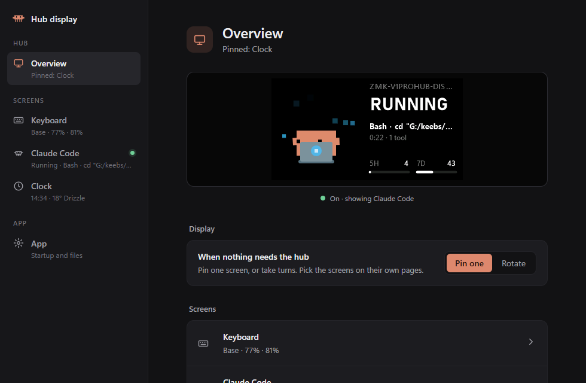</td>
<td>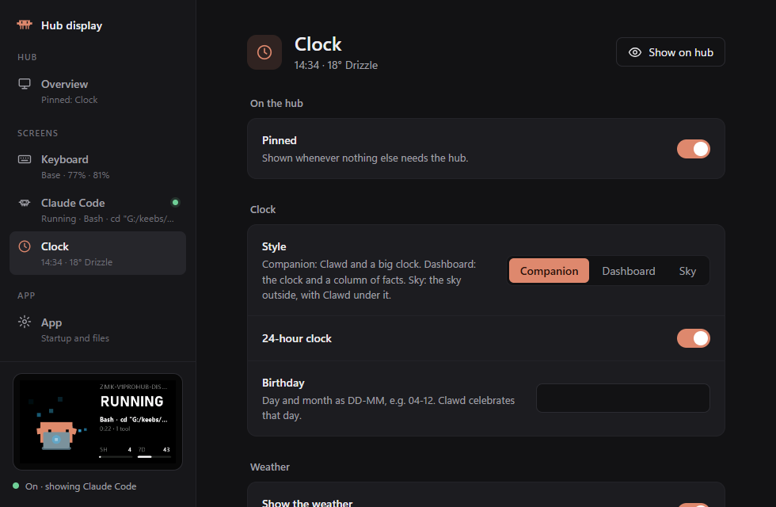</td>
</tr>
</table>

## Install

1. Download `zmk-hub-display.zip` from the
   [latest release](https://github.com/Dote3K/zmk-v1prohub-display/releases/latest).
2. Unzip it anywhere and run `zmk-hub-display.exe`. A small Clawd appears in the tray.
3. Double-click the tray icon to open the settings window. On the **App** page you can have it start
   with Windows.

Windows may warn about an unknown publisher the first time, since the app is not signed.

### What you need

- Windows 10 or 11 and the 佳点 V1 Pro hub. The brightness you set in the 佳点 app is kept.
- Chrome or Edge for the settings window (the tray menu works without it).
- For the keyboard screen: a ZMK keyboard with a dongle plugged in over USB, running firmware that
  reports its status (see [Keyboard firmware](#keyboard-firmware) below).
- For the Claude Code screen: Claude Code. Open **Claude Code** in the settings window and click
  **Install into Claude Code**. The usage bars fill in when you use Claude Code in a terminal, since
  only the terminal runs its status line.

## Credits

The pets come from [clawd-pet](https://github.com/abderrahimghazali/clawd-pet) (MIT, see
`assets/clawd-pet/LICENSE`). Clawd is Claude Code's mascot and belongs to Anthropic, PBC. This is an
unofficial fan project, not affiliated with or endorsed by Anthropic.

---

## For developers

### Build

The app is C# for .NET Framework 4 and builds with the compiler that ships with Windows, no SDK needed:

```
build.cmd
```

The exe lands in `bin\`. Settings live in `%APPDATA%\zmk-hub-display\config.json` and apply as soon
as the file is saved.

### Command line

```
zmk-hub-display.exe --pet-demo [seconds]        play every Claude Code state on the hub
zmk-hub-display.exe --pet <state> [seconds]     play one, e.g. working, needs-you, done
zmk-hub-display.exe --screen-test               fade the keyboard screen out and back in
zmk-hub-display.exe --install | --uninstall     start with Windows (also on the App page)
zmk-hub-display.exe --install-claude | --uninstall-claude
                                                hooks and status line in ~/.claude/settings.json
```

### Keyboard firmware

The keyboard screen reads a ZMK dongle that:

- is the central, connected over USB, with ZMK's default USB IDs (VID `0x1D50`, PID `0x615E`);
- has raw HID ([zmk-raw-hid](https://github.com/zzeneg/zmk-raw-hid): usage page `0xFF60`, usage
  `0x61`, 32-byte reports);
- answers with a status report: byte 0 `0xC5`, byte 1 version (1 or 2), byte 2 active layer,
  byte 3 HID modifiers, bytes 4-5 battery % of the left and right half (0 = unknown), byte 6
  active/idle (version 2), bytes 8-31 the layer name in ASCII. The app sends `0xC5` to ask for it.

Battery levels of the halves need `CONFIG_ZMK_SPLIT_BLE_CENTRAL_BATTERY_LEVEL_FETCHING=y` on the
dongle, and layer names come from `display-name` in the keymap.

### Pets

The pets are rendered from clawd-pet's animated SVGs into sprite sheets with `tools/clawd-frames`
(Node and playwright-core, using the installed Edge or Chrome):

```
cd tools/clawd-frames
npm install
node render.mjs fetch <name>
node render.mjs render
```
